# DIY Universal Boards

Open-source prototype PCBs for hobby electronics: dot-grid boards, stripboard, breadboard-layout boards, carriers for popular dev boards (Pico, ESP32, ESP8266, Nano, D1 mini, C3 SuperMini, Blue Pill), Arduino Uno and Mega proto shields, a Raspberry Pi HAT proto board and an SMD adapter. All boards use a 2.54 mm (0.1") grid, so DIP chips, pin headers and breadboard parts fit directly.

Ready-to-order Gerber files are in [`gerber/`](gerber/). Project story, per-board write-ups and a blog post are in [`docs/`](docs/). By [ElectroIoT.in](https://electroiot.in).

## Boards

| Board | Size | What's on it | Gerber |
|---|---|---|---|
| [Universal Board V2](#universal-board-v2-100--50-mm) | 100 × 50 mm | 35 × 16 dot grid + 28 edge strips | [zip](gerber/Gerber_Universal-Board-100x50-V2.zip) |
| [Universal Board 100 × 100](#universal-board-100--100-mm) | 100 × 100 mm | 35 × 35 dot grid + 66 edge strips | [zip](gerber/Gerber_Universal-Board-100x100.zip) |
| [Universal Board 90 × 70](#universal-board-90--70-mm) | 90 × 70 mm | 31 × 23 dot grid + 42 edge strips | [zip](gerber/Gerber_Universal-Board-90x70.zip) |
| [Universal Board 60 × 40](#universal-board-60--40-mm) | 60 × 40 mm | 19 × 12 dot grid + 20 edge strips | [zip](gerber/Gerber_Universal-Board-60x40.zip) |
| [Universal Board 70 × 30](#universal-board-70--30-mm) | 70 × 30 mm | 23 × 8 dot grid + 12 edge strips | [zip](gerber/Gerber_Universal-Board-70x30.zip) |
| [Stripboard](#stripboard-100--50-mm) | 100 × 50 mm | 16 copper strips × 35 holes | [zip](gerber/Gerber_Stripboard-100x50.zip) |
| [Power Rail Proto](#power-rail-proto-100--50-mm) | 100 × 50 mm | 35 × 13 dot grid + VCC/GND rails on both long edges | [zip](gerber/Gerber_Power-Rail-Proto-100x50.zip) |
| [Breadboard PCB](#breadboard-pcb-100--50-mm) | 100 × 50 mm | Half-breadboard layout, 35 columns, 4 rails | [zip](gerber/Gerber_Breadboard-PCB-100x50.zip) |
| [Mini Breadboard PCB](#mini-breadboard-pcb-60--40-mm) | 60 × 40 mm | 17 columns, 2 rails | [zip](gerber/Gerber_Mini-Breadboard-60x40.zip) |
| [Pico Proto Board](#raspberry-pi-pico-proto-board-100--50-mm) | 100 × 50 mm | Raspberry Pi Pico socket, 2 extra holes per pin, grid | [zip](gerber/Gerber_Pico-Proto-100x50.zip) |
| [ESP32 DevKit Proto Board](#esp32-devkit-38-pin-proto-board-100--50-mm) | 100 × 50 mm | 38-pin ESP32 DevKit (0.9" and 1.0" wide), grid | [zip](gerber/Gerber_ESP32-DevKit-Proto-100x50.zip) |
| [SMD Adapter Board](#smd-adapter-board-100--50-mm) | 100 × 50 mm | SOIC-16, 2× SOIC-8, 4× SOT-23, 3× 0805, 3× 1206, grid | [zip](gerber/Gerber_SMD-Adapter-100x50.zip) |
| [Uno Proto Shield](#arduino-uno-proto-shield) | 68.6 × 53.3 mm | Arduino Uno R3 shield shape, headers, grid | [zip](gerber/Gerber_Uno-Proto-Shield.zip) |
| [Mega Proto Shield](#arduino-mega-proto-shield) | 101.6 × 53.3 mm | Arduino Mega 2560 R3 shield shape, all headers, grid | [zip](gerber/Gerber_Mega-Proto-Shield.zip) |
| [Raspberry Pi HAT Proto](#raspberry-pi-hat-proto-board) | 65 × 56.5 mm | HAT size, 40-pin header, 1 linked hole per pin, grid | [zip](gerber/Gerber_RPi-HAT-Proto.zip) |
| [Arduino Nano Proto](#arduino-nano-proto-board-70--50-mm) | 70 × 50 mm | Nano socket, 2 extra holes per pin, grid | [zip](gerber/Gerber_Nano-Proto-70x50.zip) |
| [NodeMCU ESP8266 Proto](#nodemcu-esp8266-proto-board-100--50-mm) | 100 × 50 mm | NodeMCU v2 (0.9") and v3 (1.1") rows, grid | [zip](gerber/Gerber_NodeMCU-Proto-100x50.zip) |
| [Wemos D1 mini Proto](#wemos-d1-mini-proto-board-50--45-mm) | 50 × 45 mm | D1 mini socket, extra linked holes, grid | [zip](gerber/Gerber_D1-mini-Proto-50x45.zip) |
| [ESP32-C3 SuperMini Proto](#esp32-c3-supermini-proto-board-50--40-mm) | 50 × 40 mm | C3 SuperMini socket, 2 extra holes per pin, grid | [zip](gerber/Gerber_C3-SuperMini-Proto-50x40.zip) |
| [STM32 Blue Pill Proto](#stm32-blue-pill-proto-board-100--50-mm) | 100 × 50 mm | Blue Pill socket, 2 extra holes per pin, grid | [zip](gerber/Gerber_BluePill-Proto-100x50.zip) |
| [PCB Ruler 10 cm](#pcb-rulers-10-cm-and-15-cm) | 110 × 25 mm | mm + inch scales both sides, drill gauge, 11 SMD footprints | [zip](gerber/Gerber_PCB-Ruler-10cm.zip) |
| [PCB Ruler 15 cm](#pcb-rulers-10-cm-and-15-cm) | 160 × 32 mm | mm + inch scales both sides, drill + AWG gauges, pin pitches, trace widths, 21 SMD footprints | [zip](gerber/Gerber_PCB-Ruler-15cm.zip) |
| [LED Chaser Ruler 10 cm](#led-chaser-pcb-ruler-10-cm) | 120 × 32 mm | Ruler with a 555 + 4017 LED chaser, one LED per cm, CR2032 on the back | [zip](gerber/Gerber_LED-Chaser-Ruler-10cm.zip) |

The images below show the top and bottom silkscreen drawn over each other. On the real board they're on opposite sides. Blue lines are bottom-layer copper and red is top-layer copper.

## Common specs

| Item | Value |
|---|---|
| Grid pitch | 2.54 mm |
| Hole / pad | 1.0 mm plated hole, 1.8 mm round pad, both sides |
| Edge strips | 3.6 × 1.8 mm oblong pads, 1.0 mm hole |
| Mounting holes | 3.2 mm plated (M3), 5.5 mm pad, 3.5 mm from each corner (Uno shield: 3.2 mm unplated, at the Uno positions) |
| Linked holes | 0.8 mm copper tracks on the bottom layer. Cut a track with a knife to break it. |
| Corners | 1.5 mm radius |

---

### Universal Board V2 (100 × 50 mm)

The 2019 original, redrawn. It has a plated dot grid with oblong edge strips on both short ends for power entry or edge wiring.

### Universal Board (100 × 100 mm)

The biggest dot grid at 1,225 holes, for whole-project builds.

### Universal Board (90 × 70 mm)

### Universal Board (60 × 40 mm)

### Universal Board (70 × 30 mm)

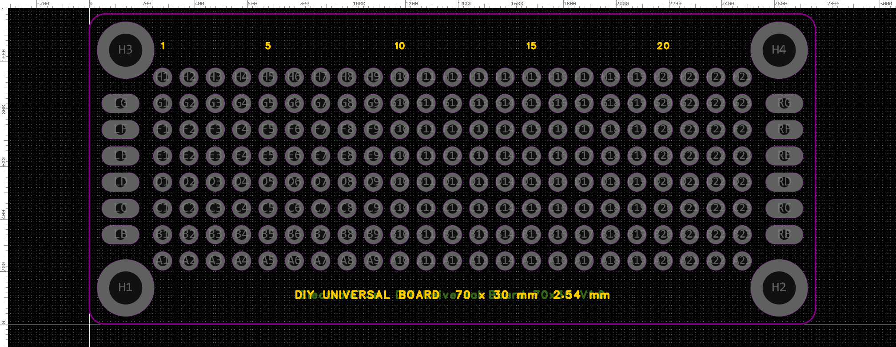

A narrow board for sensor breakouts and small modules.

### Stripboard (100 × 50 mm)

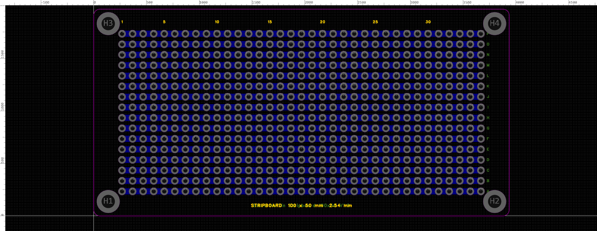

Veroboard-style board with 16 horizontal copper strips (rows A–P) on the bottom, 35 holes each. Break a strip by cutting the track between two holes, or by twisting a 3 mm drill bit in a hole by hand.

### Power Rail Proto (100 × 50 mm)

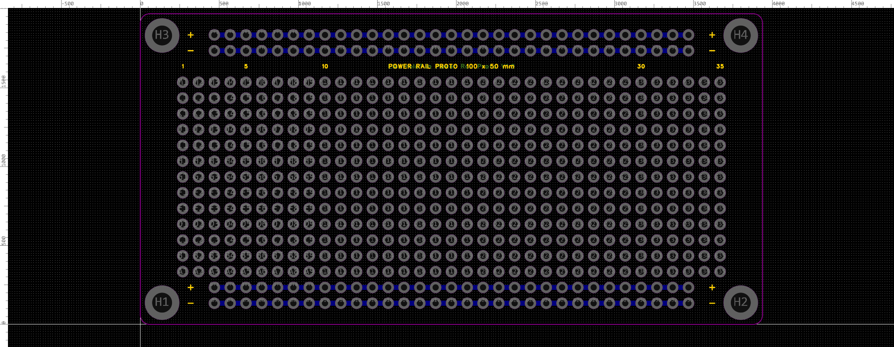

A dot grid with two rails (**+** and **−**) along each long edge, each joined end to end on the bottom layer. The top and bottom rail pairs are separate, so you can run two supply voltages.

### Breadboard PCB (100 × 50 mm)

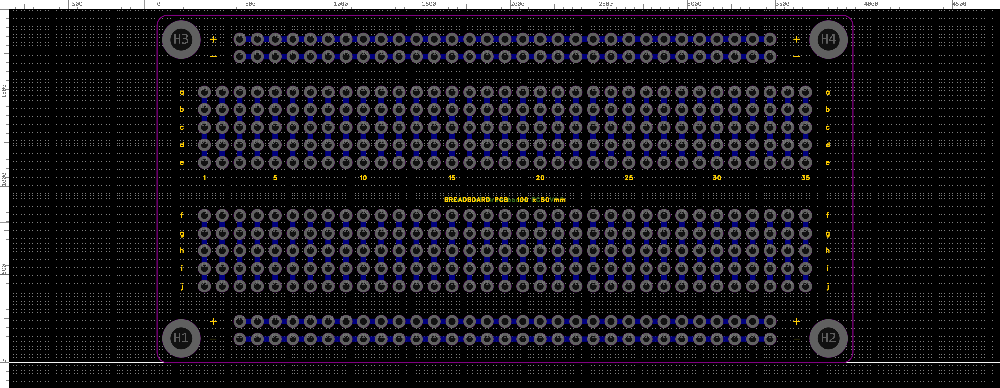

It has the same layout as a half-size breadboard, so you can move a working breadboard circuit across hole for hole and solder it.

- Rows **a–e** and **f–j**: each column of 5 holes is linked on the bottom layer.
- A centre channel between e and f fits DIP chips.
- Two power rails on each long edge, marked **+** and **−**.

### Mini Breadboard PCB (60 × 40 mm)

17 columns of a–e / f–j strips, with one **+** rail on top and one **−** rail on the bottom.

### Raspberry Pi Pico Proto Board (100 × 50 mm)

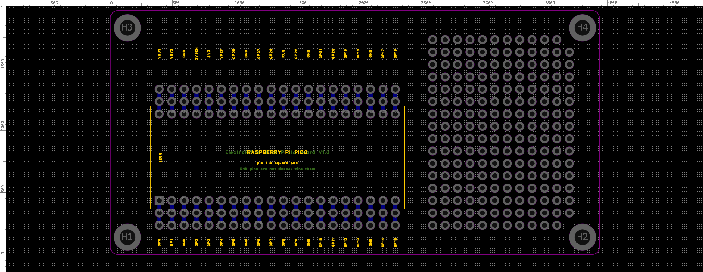

- Socket rows for a Raspberry Pi Pico / Pico W / Pico 2 (2 × 20 pins, 17.78 mm apart), with the USB end on the left.
- Every pin has **2 extra holes** linked to it on the bottom layer, for wires or parts.
- Pin names (GP0–GP28, GND, 3V3, VSYS, VBUS, RUN, …) are printed next to the holes. Pin 1 is the square pad.
- The GND pins are **not** joined together, so wire the ones you use.
- A dot grid fills the rest of the board.

### ESP32 DevKit 38-pin Proto Board (100 × 50 mm)

- For 38-pin ESP32 DevKit boards (ESP32-DevKitC pinout), with the USB end on the left.
- The top header has **two rows**: inner for 0.9" (22.86 mm) wide modules and outer for 1.0" (25.4 mm) wide ones. Both rows are linked to the same pins.
- The bottom header has 2 extra linked holes per pin, and the top has 1.
- Pin names are printed next to the holes. Pin 1 (3V3) is the square pad.
- **Check your board's pinout** before soldering. Some clone boards label or order their pins differently.

### SMD Adapter Board (100 × 50 mm)

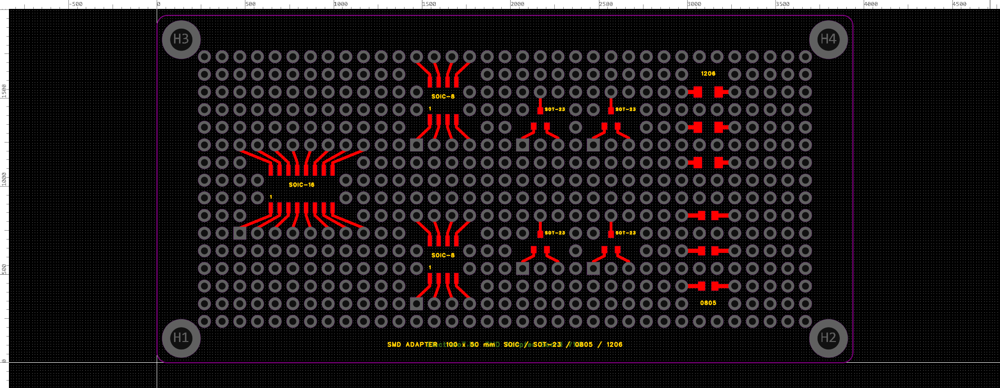

SMD footprints on the top layer, each pin wired to a 2.54 mm hole:

| Footprint | Count | Holes |
|---|---|---|
| SOIC-16 (1.27 mm pitch) | 1 | 2 rows of 8, 12.7 mm apart |
| SOIC-8 (1.27 mm pitch) | 2 | 2 rows of 4, 12.7 mm apart |
| SOT-23 | 4 | 3 holes each |
| 0805 | 3 | 2 holes each |
| 1206 | 3 | 2 holes each |

Pin-1 holes are square. The rest of the board is a dot grid.

### Arduino Uno Proto Shield

- Uno R3 board outline, with the four Uno mounting holes (3.2 mm, unplated).
- R3 headers: power (NC, IOREF, RESET, 3V3, 5V, GND, GND, VIN), A0–A5, D0–D13, GND, AREF, SDA, SCL. The 160 mil gap between D7 and D8 is included.
- Each header pin has 1 extra linked hole, and pin names are printed next to the headers.
- There's no copper over the Uno's USB-B connector, so it can't short against the shield.
- The ICSP header isn't included.

### Arduino Mega Proto Shield

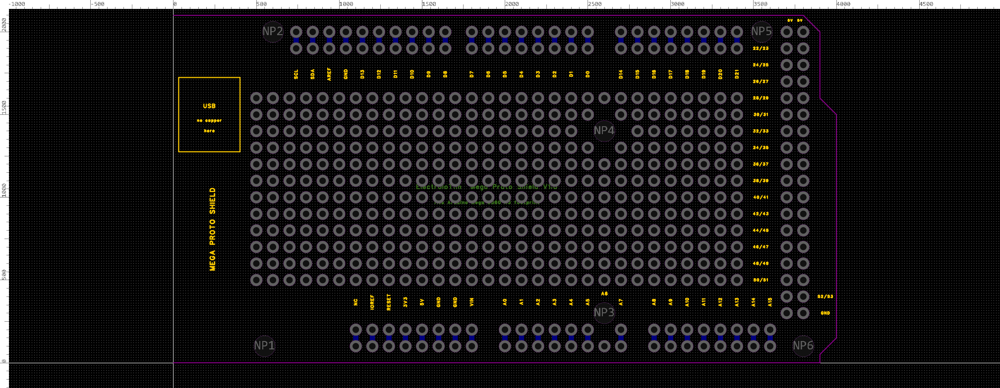

- Mega 2560 R3 board outline, with the six Mega mounting holes (3.2 mm, unplated).
- All headers: power, A0–A15, D0–D21 (including the 160 mil D7/D8 gap) and the 2 × 18 double row (5V, D22–D53, GND).
- Each pin on the long top and bottom headers has 1 extra linked hole. The double row is labelled in pairs (22/23 …).
- There's no copper over the USB-B connector. At 101.6 mm it's just over 100 mm, so some fabs charge a little more.

### Raspberry Pi HAT Proto Board

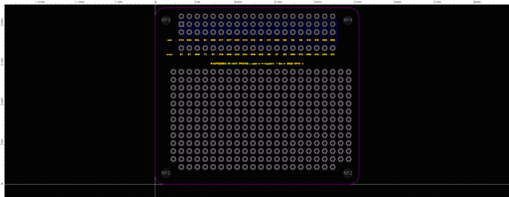

- Official HAT size: 65 × 56.5 mm with 3 mm corners, and four 2.75 mm (M2.5) mounting holes 58 × 49 mm apart.
- 40-pin header in the standard HAT position. Pin 1 (3V3) is the square pad.
- Every header pin has 1 linked hole: odd pins in the row just below the header, even pins in the row below the "odd" labels. Labels use BCM numbers (G17 = GPIO17).
- This is a HAT-*size* proto board. It doesn't include the ID EEPROM that an official HAT needs.

### Arduino Nano Proto Board (70 × 50 mm)

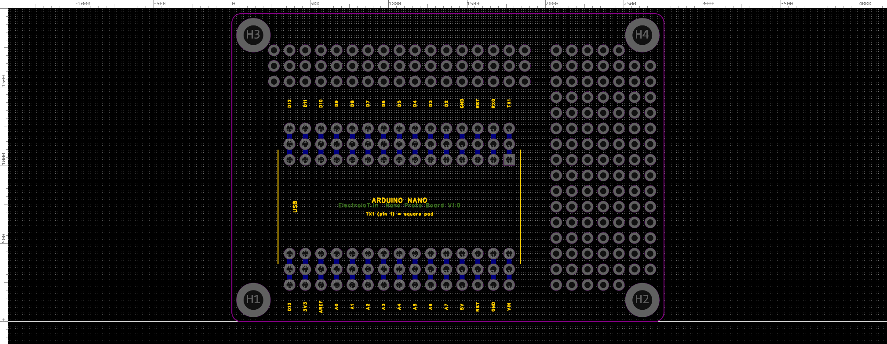

Socket rows for an Arduino Nano (2 × 15 pins, 0.6" apart) with the USB end on the left. Each pin has 2 extra linked holes and is labelled. TX1 (pin 1) is the square pad.

### NodeMCU ESP8266 Proto Board (100 × 50 mm)

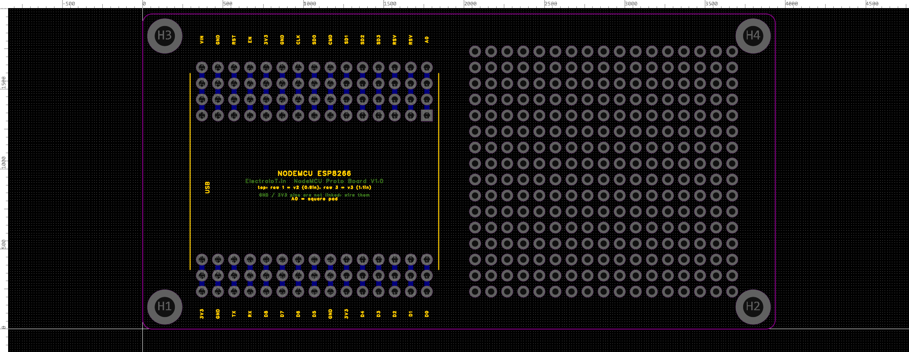

- The bottom header is fixed. The top header has linked rows for **NodeMCU v2 (0.9" wide)** and **v3 / LoLin (1.1" wide)**, so either board fits.
- Pins are labelled (A0, D0–D8, RX, TX, SD0–SD3, …). A0 is the square pad.

### Wemos D1 mini Proto Board (50 × 45 mm)

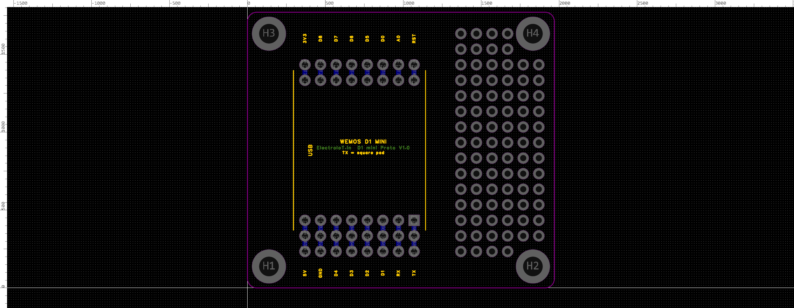

Socket rows for a Wemos / LOLIN D1 mini (2 × 8 pins, 0.9" apart), with extra linked holes and pin labels. TX is the square pad.

### ESP32-C3 SuperMini Proto Board (50 × 40 mm)

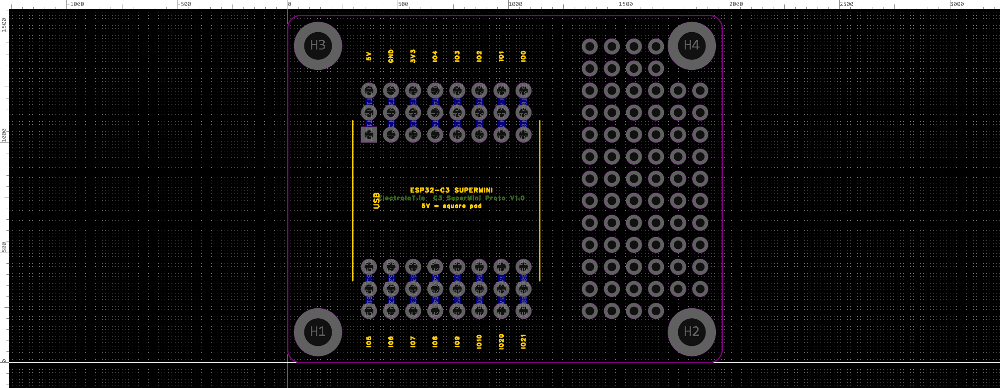

Socket rows for an ESP32-C3 SuperMini (2 × 8 pins, 0.6" apart). Each pin has 2 extra linked holes and is labelled (IO0–IO10, IO20, IO21, 5V, 3V3, GND). 5V is the square pad. Other SuperMini boards (C6, H2, S3) have the same row spacing, but their pin names are different.

### STM32 Blue Pill Proto Board (100 × 50 mm)

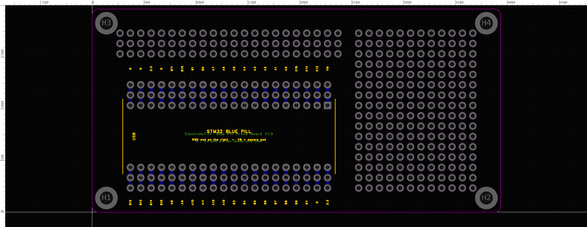

Socket rows for an STM32F103 Blue Pill (2 × 20 pins, 0.6" apart), with the USB end on the left and the SWD header end on the right. Each pin has 2 extra linked holes and is labelled. VB is the square pad. A Black Pill fits the same rows, but its pin names are different.

> **For all carrier boards:** check that the printed labels match your module's own silkscreen before soldering. Clone boards sometimes change the pin order. The GND and power pins aren't joined to each other, so wire the ones you use.

### PCB Rulers (10 cm and 15 cm)

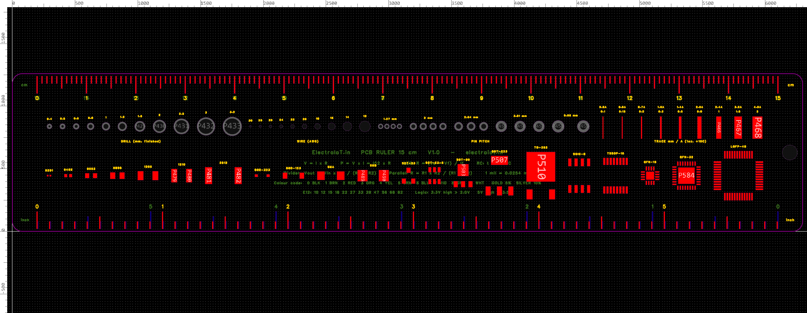

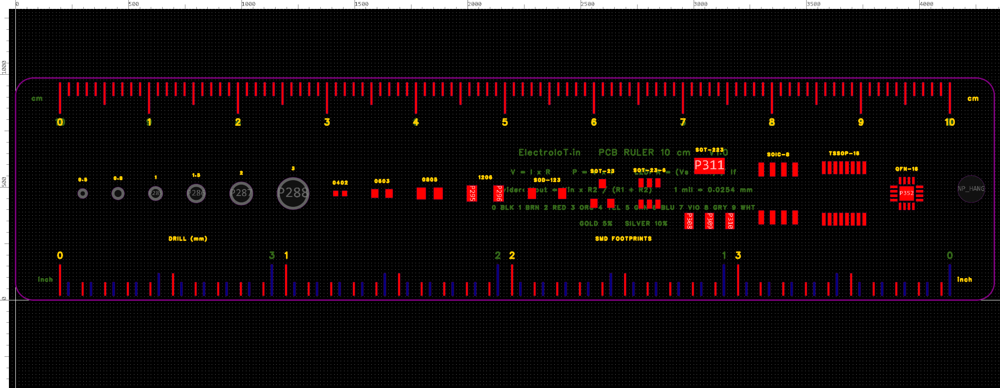

A ruler and a reference card in one board. The scale marks and footprints are bare copper with no solder mask, so with an **ENIG (gold)** finish they come out shiny gold.

| Feature | 10 cm | 15 cm |
|---|---|---|
| Size | 110 × 25 mm | 160 × 32 mm |
| mm scale (1 mm marks, 5 / 10 mm long marks) | both sides | both sides |
| inch scale (0.1" marks) | both sides | both sides |
| Drill gauge (finished plated holes) | 0.5 – 3.0 mm, 6 sizes | 0.4 – 3.2 mm, 11 sizes |
| Wire gauge holes (unplated, wire Ø + 0.1 mm) | — | AWG 30 – 12 |
| Pin pitch samples | — | 1.27, 2.0, 2.54, 3.81, 5.08 mm |
| Trace widths with current rating (1 oz copper, +10 °C, IPC-2221) | — | 0.1 – 2.0 mm |
| SMD footprints | 0402, 0603, 0805, 1206, SOD-123, SOT-23, SOT-23-6, SOT-223, SOIC-8, TSSOP-16, QFN-16 | 0201 – 2512, SOD-323, SOD-123, SMA, SMB, SOT-23, SOT-23-6, SOT-89, SOT-223, TO-252, SOIC-8, TSSOP-16, QFN-16, QFN-32, LQFP-48 |
| Back side | Ohm's law, LED resistor, divider, colour code | Same, plus RC, parallel resistors, E12 values and logic levels |
| Hanging hole | 3 mm | 3 mm |

The scales are on both sides, and each side reads left to right when that side is facing up. Order with **ENIG**, any mask colour (black or blue make the gold stand out), 1.6 mm FR-4. At 110 mm and 160 mm long, the rulers cost a little more than boards under 100 × 100 mm.

### LED Chaser PCB Ruler (10 cm)

A working circuit on a ruler. A TLC555 clock drives a 74HC4017 counter, and a light runs along the centimetre marks, one LED per cm. It runs from a CR2032 on the back, with an ON/OFF slide switch and a speed trimmer (about 1.4–12 Hz). It also makes a good SMD soldering practice kit: SOIC-8, SOIC-16 and 0805 parts. It has mm and inch scales on both sides and a small drill gauge.

The full circuit description, netlist, parts list and assembly steps are in [docs/led-chaser-ruler.md](docs/led-chaser-ruler.md). The design passes EasyEDA's design rule check with 0 errors, but it **hasn't been built and tested yet**.

## Ordering

Upload a zip from `gerber/` to any PCB fab and use these settings:

- 2 layers, FR-4, 1.6 mm thick
- HASL finish (lead-free is better if you give boards away)
- Any solder mask colour, white silkscreen
- No special options needed. Minimum hole size is 1.0 mm.

Each zip has top/bottom copper, solder mask and silkscreen, the board outline, the drill files and the drill drawing. The SMD adapter also has a top paste layer.

## License

[CC BY-SA 4.0](LICENSE): free to use, change and sell, with attribution and under the same license. By [ElectroIoT.in](https://electroiot.in).
