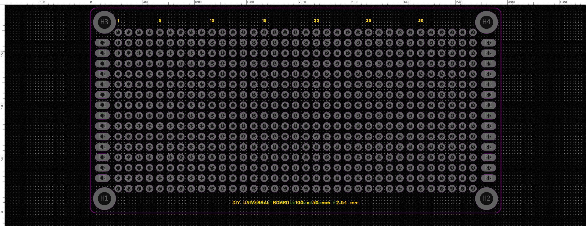
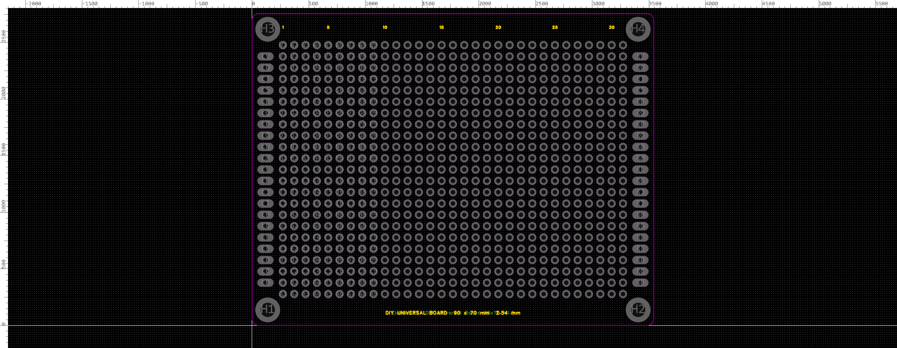

# DIY Universal Boards

Open-source prototype PCBs for hobby electronics: plated-through dot-grid boards in three sizes and a breadboard-layout board. All boards use a 2.54 mm (0.1") grid, so DIP chips, pin headers and breadboard parts fit directly.

Ready-to-order Gerber files are in [`gerber/`](gerber/).

| Board | Size | Holes | Gerber |
|---|---|---|---|
| Universal Board V2 | 100 × 50 mm | 35 × 16 grid (560) + 28 edge strips + 4 M3 | [zip](gerber/Gerber_Universal-Board-100x50-V2.zip) |
| Breadboard PCB | 100 × 50 mm | 35 columns, a–e / f–j 5-hole strips, 4 power rails, 4 M3 | [zip](gerber/Gerber_Breadboard-PCB-100x50.zip) |
| Universal Board | 90 × 70 mm | 31 × 23 grid (713) + 42 edge strips + 4 M3 | [zip](gerber/Gerber_Universal-Board-90x70.zip) |
| Universal Board | 60 × 40 mm | 19 × 12 grid (228) + 20 edge strips + 4 M3 | [zip](gerber/Gerber_Universal-Board-60x40.zip) |

## Universal Board V2 (100 × 50 mm)

The 2019 original, redrawn. It has a plated dot grid with oblong edge strips on both short ends for power entry or edge wiring. The top silkscreen has column numbers.

## Breadboard PCB (100 × 50 mm)

It has the same layout as a half-size breadboard, so you can move a working breadboard circuit across hole for hole and solder it.

- Rows **a–e** and **f–j**: each column of 5 holes is joined by a 0.8 mm copper track on the **bottom** layer.
- A centre channel between e and f fits DIP chips.
- Two power rails on each long edge, marked **+** and **−**. Each rail is 31 holes, joined end to end.
- To break a strip or rail, cut the track on the bottom with a knife.

## Universal Board (90 × 70 mm)

## Universal Board (60 × 40 mm)

## Common specs

| Item | Value |
|---|---|
| Grid pitch | 2.54 mm |
| Hole / pad | 1.0 mm plated hole, 1.8 mm round pad, both sides |
| Edge strips | 3.6 × 1.8 mm oblong pads, 1.0 mm hole |
| Mounting holes | 3.2 mm plated (M3), 5.5 mm pad, 3.5 mm from each corner |
| Corners | 1.5 mm radius |

The images above show the top and bottom silkscreen drawn over each other. On the real board they're on opposite sides.

## Ordering

Upload a zip from `gerber/` to any PCB fab and use these settings:

- 2 layers, FR-4, 1.6 mm thick
- HASL finish (lead-free is better if you give boards away)
- Any solder mask colour, white silkscreen
- No special options needed. Minimum hole size is 1.0 mm.

Each zip has top/bottom copper, solder mask and silkscreen, the board outline, the plated-drill file and the drill drawing.

## License

[CC BY-SA 4.0](LICENSE): free to use, change and sell, with attribution and under the same license. By ElectroIoT.
