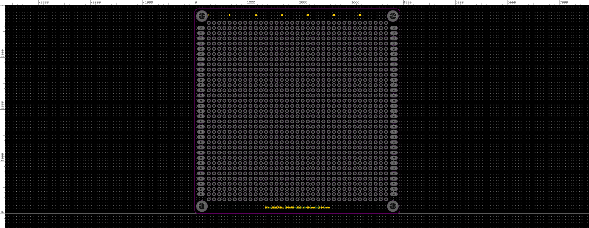
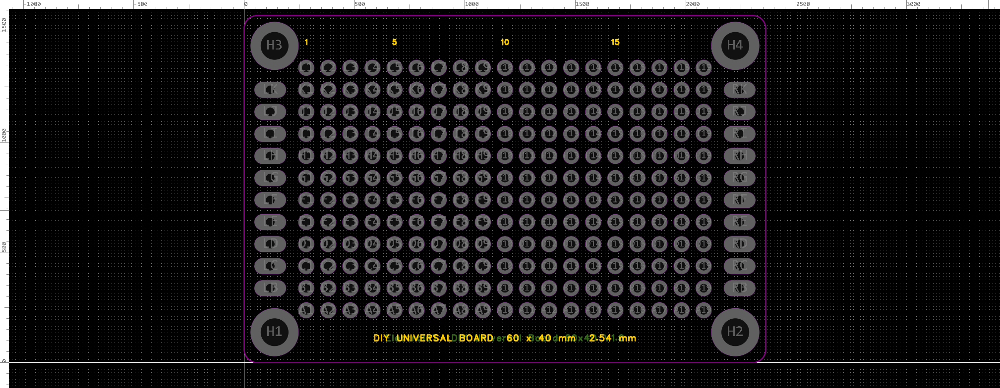
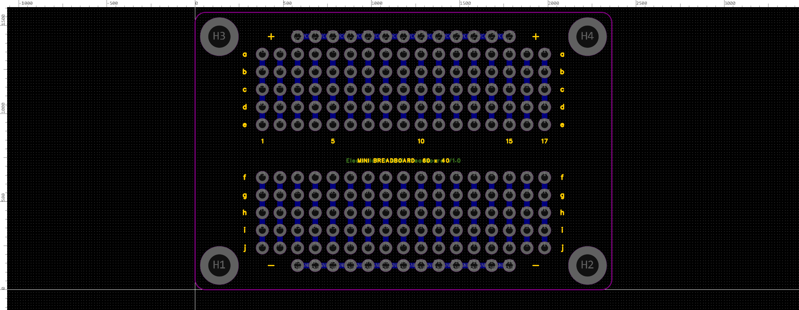
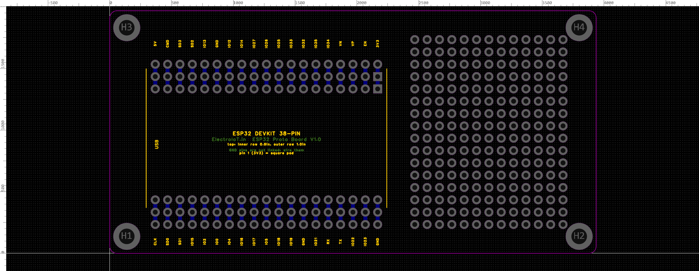
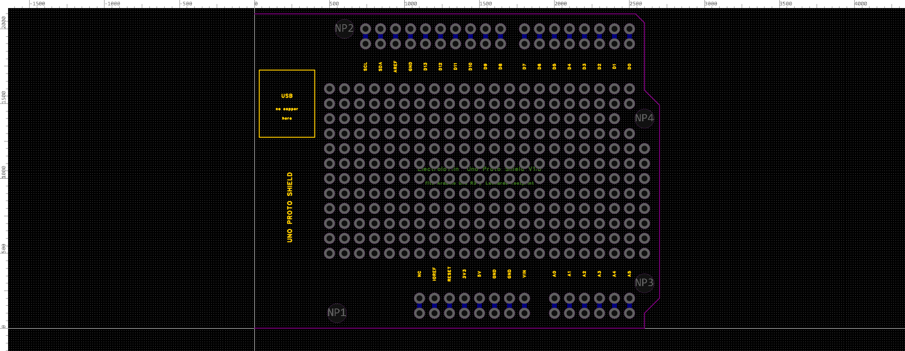

# DIY Universal Boards

Open-source prototype PCBs for hobby electronics: dot-grid boards, stripboard, breadboard-layout boards, module carriers (Raspberry Pi Pico, ESP32 DevKit), an SMD adapter and an Arduino Uno proto shield. All boards use a 2.54 mm (0.1") grid, so DIP chips, pin headers and breadboard parts fit directly.

Ready-to-order Gerber files are in [`gerber/`](gerber/). By [ElectroIoT.in](https://electroiot.in).

## Boards

| Board | Size | What's on it | Gerber |
|---|---|---|---|
| [Universal Board V2](#universal-board-v2-100--50-mm) | 100 × 50 mm | 35 × 16 dot grid + 28 edge strips | [zip](gerber/Gerber_Universal-Board-100x50-V2.zip) |
| [Universal Board 100 × 100](#universal-board-100--100-mm) | 100 × 100 mm | 35 × 35 dot grid + 66 edge strips | [zip](gerber/Gerber_Universal-Board-100x100.zip) |
| [Universal Board 90 × 70](#universal-board-90--70-mm) | 90 × 70 mm | 31 × 23 dot grid + 42 edge strips | [zip](gerber/Gerber_Universal-Board-90x70.zip) |
| [Universal Board 60 × 40](#universal-board-60--40-mm) | 60 × 40 mm | 19 × 12 dot grid + 20 edge strips | [zip](gerber/Gerber_Universal-Board-60x40.zip) |
| [Universal Board 70 × 30](#universal-board-70--30-mm) | 70 × 30 mm | 23 × 8 dot grid + 12 edge strips | [zip](gerber/Gerber_Universal-Board-70x30.zip) |
| [Stripboard](#stripboard-100--50-mm) | 100 × 50 mm | 16 copper strips × 35 holes | [zip](gerber/Gerber_Stripboard-100x50.zip) |
| [Power Rail Proto](#power-rail-proto-100--50-mm) | 100 × 50 mm | 35 × 13 dot grid + VCC/GND rails on both long edges | [zip](gerber/Gerber_Power-Rail-Proto-100x50.zip) |
| [Breadboard PCB](#breadboard-pcb-100--50-mm) | 100 × 50 mm | Half-breadboard layout, 35 columns, 4 rails | [zip](gerber/Gerber_Breadboard-PCB-100x50.zip) |
| [Mini Breadboard PCB](#mini-breadboard-pcb-60--40-mm) | 60 × 40 mm | 17 columns, 2 rails | [zip](gerber/Gerber_Mini-Breadboard-60x40.zip) |
| [Pico Proto Board](#raspberry-pi-pico-proto-board-100--50-mm) | 100 × 50 mm | Raspberry Pi Pico socket, 2 extra holes per pin, grid | [zip](gerber/Gerber_Pico-Proto-100x50.zip) |
| [ESP32 DevKit Proto Board](#esp32-devkit-38-pin-proto-board-100--50-mm) | 100 × 50 mm | 38-pin ESP32 DevKit (0.9" and 1.0" wide), grid | [zip](gerber/Gerber_ESP32-DevKit-Proto-100x50.zip) |
| [SMD Adapter Board](#smd-adapter-board-100--50-mm) | 100 × 50 mm | SOIC-16, 2× SOIC-8, 4× SOT-23, 3× 0805, 3× 1206, grid | [zip](gerber/Gerber_SMD-Adapter-100x50.zip) |
| [Uno Proto Shield](#arduino-uno-proto-shield) | 68.6 × 53.3 mm | Arduino Uno R3 shield shape, headers, grid | [zip](gerber/Gerber_Uno-Proto-Shield.zip) |

The images below show the top and bottom silkscreen drawn over each other. On the real board they're on opposite sides. Blue lines are bottom-layer copper and red is top-layer copper.

## Common specs

| Item | Value |
|---|---|
| Grid pitch | 2.54 mm |
| Hole / pad | 1.0 mm plated hole, 1.8 mm round pad, both sides |
| Edge strips | 3.6 × 1.8 mm oblong pads, 1.0 mm hole |
| Mounting holes | 3.2 mm plated (M3), 5.5 mm pad, 3.5 mm from each corner (Uno shield: 3.2 mm unplated, at the Uno positions) |
| Linked holes | 0.8 mm copper tracks on the bottom layer. Cut a track with a knife to break it. |
| Corners | 1.5 mm radius |

---

### Universal Board V2 (100 × 50 mm)

The 2019 original, redrawn. It has a plated dot grid with oblong edge strips on both short ends for power entry or edge wiring.

### Universal Board (100 × 100 mm)

The biggest dot grid at 1,225 holes, for whole-project builds.

### Universal Board (90 × 70 mm)

### Universal Board (60 × 40 mm)

### Universal Board (70 × 30 mm)

A narrow board for sensor breakouts and small modules.

### Stripboard (100 × 50 mm)

Veroboard-style board with 16 horizontal copper strips (rows A–P) on the bottom, 35 holes each. Break a strip by cutting the track between two holes, or by twisting a 3 mm drill bit in a hole by hand.

### Power Rail Proto (100 × 50 mm)

A dot grid with two rails (**+** and **−**) along each long edge, each joined end to end on the bottom layer. The top and bottom rail pairs are separate, so you can run two supply voltages.

### Breadboard PCB (100 × 50 mm)

It has the same layout as a half-size breadboard, so you can move a working breadboard circuit across hole for hole and solder it.

- Rows **a–e** and **f–j**: each column of 5 holes is linked on the bottom layer.
- A centre channel between e and f fits DIP chips.
- Two power rails on each long edge, marked **+** and **−**.

### Mini Breadboard PCB (60 × 40 mm)

17 columns of a–e / f–j strips, with one **+** rail on top and one **−** rail on the bottom.

### Raspberry Pi Pico Proto Board (100 × 50 mm)

- Socket rows for a Raspberry Pi Pico / Pico W / Pico 2 (2 × 20 pins, 17.78 mm apart), with the USB end on the left.
- Every pin has **2 extra holes** linked to it on the bottom layer, for wires or parts.
- Pin names (GP0–GP28, GND, 3V3, VSYS, VBUS, RUN, …) are printed next to the holes. Pin 1 is the square pad.
- The GND pins are **not** joined together, so wire the ones you use.
- A dot grid fills the rest of the board.

### ESP32 DevKit 38-pin Proto Board (100 × 50 mm)

- For 38-pin ESP32 DevKit boards (ESP32-DevKitC pinout), with the USB end on the left.
- The top header has **two rows**: inner for 0.9" (22.86 mm) wide modules and outer for 1.0" (25.4 mm) wide ones. Both rows are linked to the same pins.
- The bottom header has 2 extra linked holes per pin, and the top has 1.
- Pin names are printed next to the holes. Pin 1 (3V3) is the square pad.
- **Check your board's pinout** before soldering. Some clone boards label or order their pins differently.

### SMD Adapter Board (100 × 50 mm)

SMD footprints on the top layer, each pin wired to a 2.54 mm hole:

| Footprint | Count | Holes |
|---|---|---|
| SOIC-16 (1.27 mm pitch) | 1 | 2 rows of 8, 12.7 mm apart |
| SOIC-8 (1.27 mm pitch) | 2 | 2 rows of 4, 12.7 mm apart |
| SOT-23 | 4 | 3 holes each |
| 0805 | 3 | 2 holes each |
| 1206 | 3 | 2 holes each |

Pin-1 holes are square. The rest of the board is a dot grid.

### Arduino Uno Proto Shield

- Uno R3 board outline, with the four Uno mounting holes (3.2 mm, unplated).
- R3 headers: power (NC, IOREF, RESET, 3V3, 5V, GND, GND, VIN), A0–A5, D0–D13, GND, AREF, SDA, SCL. The 160 mil gap between D7 and D8 is included.
- Each header pin has 1 extra linked hole, and pin names are printed next to the headers.
- There's no copper over the Uno's USB-B connector, so it can't short against the shield.
- The ICSP header isn't included.

## Ordering

Upload a zip from `gerber/` to any PCB fab and use these settings:

- 2 layers, FR-4, 1.6 mm thick
- HASL finish (lead-free is better if you give boards away)
- Any solder mask colour, white silkscreen
- No special options needed. Minimum hole size is 1.0 mm.

Each zip has top/bottom copper, solder mask and silkscreen, the board outline, the drill files and the drill drawing. The SMD adapter also has a top paste layer.

## License

[CC BY-SA 4.0](LICENSE): free to use, change and sell, with attribution and under the same license. By [ElectroIoT.in](https://electroiot.in).
