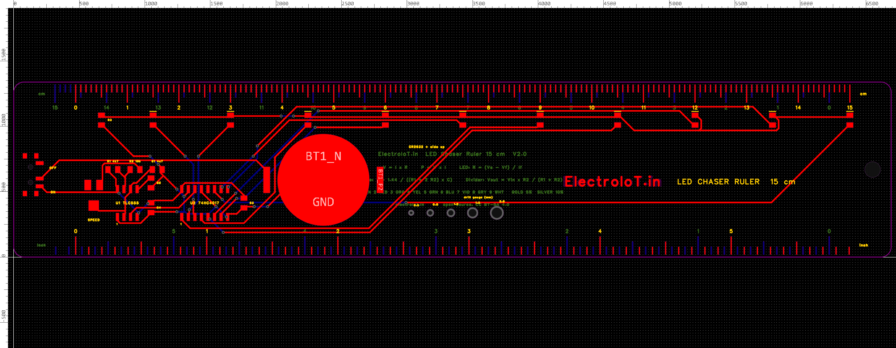
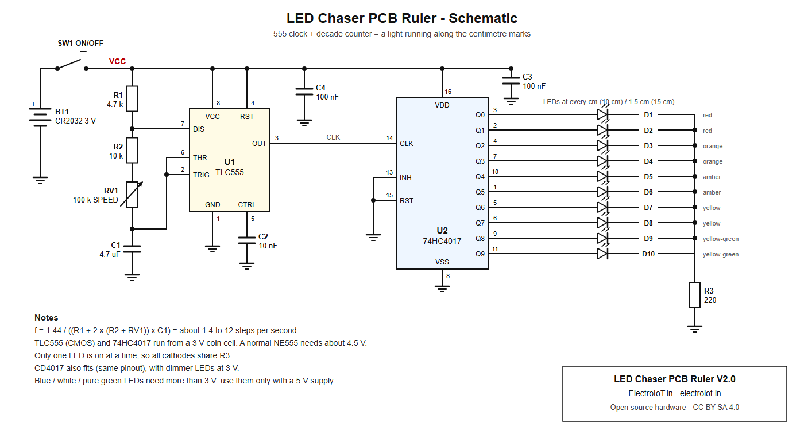

# LED Chaser PCB Ruler (10 cm and 15 cm), V2

A PCB ruler with a working circuit on it: a **rainbow light runs along the scale**. It runs from a CR2032 coin cell, and the speed is set with a small trimmer. It's also a good **SMD soldering practice kit**: SOIC-8, SOIC-16, 0805 parts, a trimmer and a slide switch.

**New in V2: every part is on the top side.** The back is completely flat, with only the copper scales and printing, so the ruler lies flat on the bench and you can still measure with it.

| 10 cm | 15 cm |
|---|---|
|  |  |

## Schematic

Vector version: [led-chaser-ruler-schematic.svg](led-chaser-ruler-schematic.svg)

## Boards

| | 10 cm | 15 cm |
|---|---|---|
| Size | 120 × 34 mm | 170 × 34 mm |
| LEDs | 10, one at every cm (1–10 cm) | 10, one every 1.5 cm (1.5, 3.0 … 15.0 cm) |
| Scales | mm and inch, copper, both sides | mm and inch, copper, both sides |
| Parts | all on top, back is flat | all on top, back is flat |
| Extras | drill gauge 0.5–2.0 mm, gold "ElectroIoT.in" logo, formulas and colour code on the back, hanging hole | same, with a bigger logo |
| Gerber | [`Gerber_LED-Chaser-Ruler-10cm.zip`](../gerber/Gerber_LED-Chaser-Ruler-10cm.zip) | [`Gerber_LED-Chaser-Ruler-15cm.zip`](../gerber/Gerber_LED-Chaser-Ruler-15cm.zip) |

Both boards pass EasyEDA's design rule check with **0 errors**, including connectivity. **They haven't been built and tested yet.**

## Make it colourful

PCB colour comes from the order options, and the LEDs add the rest:

| Look | Solder mask | Silkscreen | Finish |
|---|---|---|---|
| **Black & gold (recommended)** | Matte black | White | **ENIG** |
| Classic | Blue | White | ENIG |
| Bold | Purple | White | ENIG |
| Bright | Red or green | White | ENIG |

- With **ENIG**, the scale marks, footprint pads and the "ElectroIoT.in" logo come out shiny gold. The logo is exposed copper with no mask on it.
- **Rainbow LEDs:** fit the LEDs as a colour gradient (red → orange → amber → yellow → yellow-green). All of these light well from a 3 V coin cell.
- Blue, white and pure green LEDs need about 3 V or more, so they will be dim or won't light from a CR2032. Use them only if you power the board from 5 V.

## How it works

- **U1 TLC555** is a CMOS 555 in astable mode. It makes the clock: f ≈ 1.44 / ((R1 + 2·(R2+RV1))·C1), roughly **1.4 to 12 steps per second** across the RV1 range.
- **U2 74HC4017** turns on one output per clock pulse, Q0 → Q9 and round again. Each output drives one LED.
- Only one LED is on at a time, so all cathodes share one resistor (R3).
- A normal NE555 needs about 4.5 V. The TLC555 runs from 2 V, so it works from a coin cell. A CD4017 also fits the 74HC4017 footprint, but its LEDs are dimmer at 3 V.

## Netlist

| Net | Connections |
|---|---|
| VBAT | BT1 +, SW1 pin 2 (common) |
| VCC | SW1 pin 3, U1-4, U1-8, R1, C4, U2-16, C3 |
| GND | BT1 − (round pad under the cell), U1-1, C1, C2, C4, U2-8, U2-13, U2-15, C3, R3 |
| DIS | U1-7, R1, R2 |
| RVA | R2, RV1-1 |
| THR | U1-2, U1-6, RV1-2 (wiper), C1 |
| CTRL | U1-5, C2 |
| CLK | U1-3, U2-14 |
| Q0…Q9 | U2 pins 3, 2, 4, 7, 10, 1, 5, 6, 9, 11 → D1…D10 anodes |
| LEDK | D1…D10 cathodes, R3 |

## Parts list (BOM)

| Ref | Qty | Value | Package | Example part |
|---|---|---|---|---|
| U1 | 1 | TLC555 (CMOS 555) | SOIC-8 | TLC555CDR / LMC555 / ICM7555 |
| U2 | 1 | 74HC4017 (or CD4017) | SOIC-16 | 74HC4017D |
| D1, D2 | 2 | LED red | 0805 | |
| D3, D4 | 2 | LED orange | 0805 | |
| D5, D6 | 2 | LED amber | 0805 | |
| D7, D8 | 2 | LED yellow | 0805 | |
| D9, D10 | 2 | LED yellow-green (570 nm) | 0805 | |
| R1 | 1 | 4.7 kΩ | 0805 | |
| R2 | 1 | 10 kΩ | 0805 | |
| R3 | 1 | 220 Ω | 0805 | |
| C1 | 1 | 4.7 µF, 10 V | 0805 | X5R / X7R |
| C2 | 1 | 10 nF | 0805 | |
| C3, C4 | 2 | 100 nF | 0805 | |
| RV1 | 1 | 100 kΩ trimmer | 3 mm SMD | Bourns 3314J-1-104E |
| SW1 | 1 | Slide switch SPDT | SMD | C&K PCM12SMTR |
| BT1 | 1 | CR2032 holder, top side | SMD | Keystone 3034 |
| — | 1 | CR2032 cell | | |

## Assembly

1. Solder **U1 and U2 first**. Pin 1 is marked "1" on the silkscreen.
2. Then the 0805 resistors and capacitors.
3. Then the **LEDs, cathode toward the top edge** (under the short printed bar), in rainbow order from D1 to D10.
4. Then RV1 and SW1.
5. Last, the **battery holder** (BT1) on top. The round gold pad under it is the battery's minus contact, so keep it clean and don't put solder on it. Fit the CR2032 **+ side up**.
6. Switch ON and turn RV1 to set the speed.
