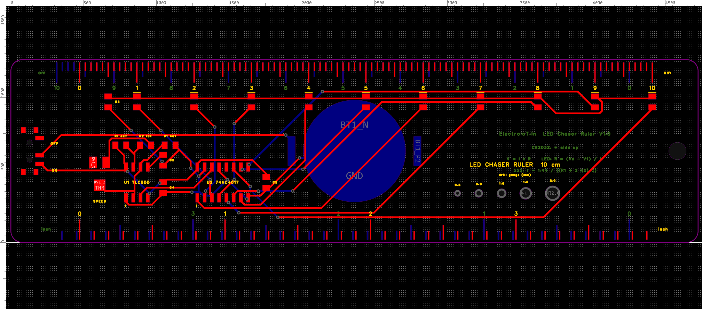

# LED Chaser PCB Ruler (10 cm)

A 10 cm PCB ruler with a working circuit on it: a light runs along the centimetre marks, one LED per cm. It runs from a CR2032 coin cell on the back, and the speed is set with a small trimmer. It's a good **SMD soldering practice kit** too: SOIC-8, SOIC-16, 0805 parts, a trimmer and a slide switch.



## Board

| Item | Value |
|---|---|
| Size | 120 × 32 mm, 2 layers, 1.6 mm FR-4 |
| Scales | mm and inch, copper, on both sides |
| LEDs | 10, one under each cm mark (1–10 cm) |
| Power | CR2032 coin cell (holder on the back), slide switch ON/OFF |
| Extras | Drill gauge 0.5 / 0.8 / 1.0 / 1.5 / 2.0 mm, formulas on the back, hanging hole |
| Gerber | [`gerber/Gerber_LED-Chaser-Ruler-10cm.zip`](../gerber/Gerber_LED-Chaser-Ruler-10cm.zip) |
| Order | ENIG (gold) recommended: it looks best and gives a good battery contact |

## How it works

```
CR2032 ──SW1── VCC ─┬──────────────┬───────────────┐
                    │              │               │
                  R1 4k7       U1 TLC555        U2 74HC4017
                    │          (astable)        (decade counter)
                   DIS ─R2 10k─ RV1 100k ─ THR/TRIG ── C1 4.7µF ── GND
                               U1 OUT ──────────► CLK (pin 14)
                                                  Q0 … Q9 ──► D1 … D10 (anodes)
                                                  LED cathodes ── R3 220Ω ── GND
```

- **U1 TLC555** is a CMOS 555 in astable mode. It makes the clock. The speed is f ≈ 1.44 / ((R1 + 2·(R2+RV1))·C1), roughly **1.4 Hz to 12 Hz** across the RV1 range.
- **U2 74HC4017** steps one output high on every clock pulse: Q0 → Q9, then back to Q0. Each output drives one LED, so the light moves 1 cm at a time.
- Only one LED is on at a time, so all the cathodes share one resistor (R3).
- **Why TLC555 and 74HC4017:** a normal NE555 needs about 4.5 V and won't run from a 3 V coin cell. The CMOS TLC555 runs from 2 V. The 74HC4017 is pin-compatible with the CD4017 but works well at 3 V and drives the LEDs brighter. A CD4017 also fits the footprint, but the LEDs are dimmer at 3 V.

## Netlist

| Net | Connections |
|---|---|
| VBAT | BT1 +, SW1 pin 2 (common) |
| VCC | SW1 pin 3, U1-4, U1-8, R1, C4, U2-16, C3 |
| GND | BT1 − (large round pad), U1-1, C1, C2, C4, U2-8, U2-13, U2-15, C3, R3 |
| DIS | U1-7, R1, R2 |
| RVA | R2, RV1-1 |
| THR | U1-2, U1-6, RV1-2 (wiper), C1 |
| CTRL | U1-5, C2 |
| CLK | U1-3, U2-14 |
| Q0…Q9 | U2 pins 3, 2, 4, 7, 10, 1, 5, 6, 9, 11 → D1…D10 anodes |
| LEDK | D1…D10 cathodes, R3 |

## Parts list (BOM)

| Ref | Qty | Value | Package | Example part |
|---|---|---|---|---|
| U1 | 1 | TLC555 (CMOS 555) | SOIC-8 | TLC555CDR / LMC555 / ICM7555 |
| U2 | 1 | 74HC4017 (or CD4017) | SOIC-16 | 74HC4017D |
| D1–D10 | 10 | LED, red (or any colour) | 0805 | any 0805 LED |
| R1 | 1 | 4.7 kΩ | 0805 | |
| R2 | 1 | 10 kΩ | 0805 | |
| R3 | 1 | 220 Ω | 0805 | |
| C1 | 1 | 4.7 µF, 10 V | 0805 | X5R / X7R |
| C2 | 1 | 10 nF | 0805 | |
| C3, C4 | 2 | 100 nF | 0805 | |
| RV1 | 1 | 100 kΩ trimmer | 3 mm SMD | Bourns 3314J-1-104E |
| SW1 | 1 | Slide switch SPDT | SMD | C&K PCM12SMTR |
| BT1 | 1 | CR2032 holder | SMD, back side | Keystone 3034 |
| — | 1 | CR2032 cell | | |

## Assembly tips

1. Solder the **ICs first** (U1, U2). Pin 1 is marked "1" on the silkscreen.
2. Then the 0805 resistors and capacitors, then the **LEDs: cathode toward the top edge**, under the short printed bar.
3. Then RV1 and SW1.
4. Last, turn the board over and solder the **battery holder** on the back. Fit the CR2032 **+ side up** (the + side touches the holder spring).
5. Switch ON and turn RV1 to set the speed.

## Design checks

- Every net is routed and EasyEDA's design rule check passes with **0 errors**, including connectivity.
- Tracks are 0.3 mm with 0.2 mm clearance, and vias are 0.3 / 0.6 mm. These are standard fab capabilities.
- **The board hasn't been built and tested yet.** The footprints for the holder, switch and trimmer come from the KiCad library for the parts listed above. If you use different parts, check that their footprints match.
