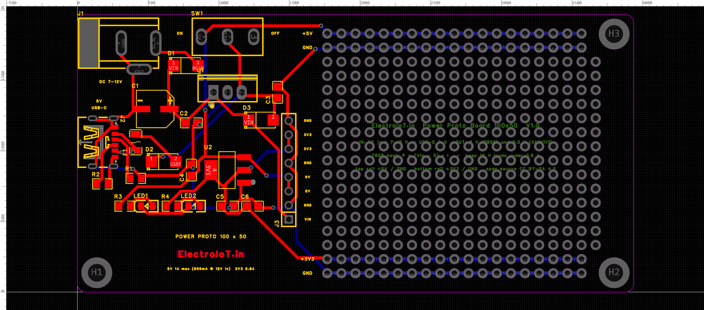
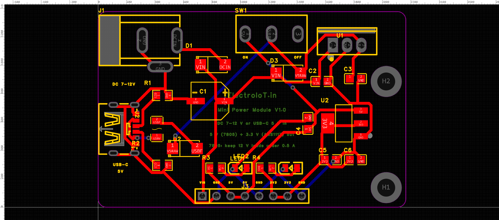
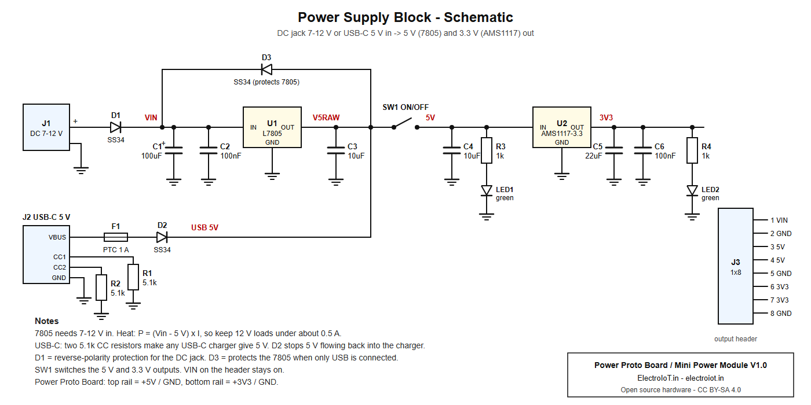

# Power Proto Board and Mini Power Module

Two boards that share one **built-in power supply**: power a project from a **DC adapter (7–12 V)** or a **USB-C phone charger (5 V)** and get regulated **5 V** and **3.3 V**.

| Power Proto Board 100 × 50 mm | Mini Power Module 55 × 35 mm |
|---|---|
|  |  |

- **Power Proto Board:** the power block at the left end, a **+5 V / GND rail along the top**, a **+3.3 V / GND rail along the bottom**, and a dot grid in the middle. Build the whole project on one board.
- **Mini Power Module:** the same power block on its own. Outputs are on a 1 × 8 2.54 mm header (VIN, GND, 5V, 5V, GND, 3V3, 3V3, GND), so it plugs into a breadboard or onto any proto board.

Both boards pass EasyEDA's design rule check with **0 errors**. **They haven't been built and tested yet.**

## Schematic

Vector version: [power-supply-schematic.svg](power-supply-schematic.svg). The EasyEDA projects (**"Power Proto Board 100x50"** and **"Mini Power Module"**) have the full schematic on page **P1**, using real LCSC library parts.

## How it works

| Block | Parts | What it does |
|---|---|---|
| DC input | J1 DC jack 5.5 × 2.1 mm, D1 SS34 | 7–12 V adapter in. D1 blocks a reversed adapter |
| 5 V regulator | U1 L7805 (TO-220), C1 100 µF, C2 100 nF, C3 10 µF | Makes 5 V from the DC input |
| USB-C input | J2 USB-C (power only), R1/R2 5.1 kΩ, F1 PTC 1 A, D2 SS34 | 5 V from any USB-C charger. The CC resistors ask the charger for 5 V, the PTC protects against shorts, and D2 stops 5 V going back into the charger |
| 7805 protection | D3 SS34 | Protects the 7805 when only USB is connected |
| Power switch | SW1 slide switch, 3 A | Switches the 5 V and 3.3 V outputs. VIN stays on |
| 3.3 V regulator | U2 AMS1117-3.3, C4 10 µF, C5 22 µF, C6 100 nF | Makes 3.3 V from 5 V, up to about 0.8 A |
| Power LEDs | LED1 + R3 (5 V), LED2 + R4 (3.3 V) | Show that each output is on |

### Limits

- **7805 heat:** P = (Vin − 5 V) × I. At 12 V in and 0.5 A, that's 3.5 W, which is the practical limit without a heatsink. With a 9 V adapter you can take more current. The TO-220 can take a small clip-on heatsink.
- **USB-C:** up to the charger's 5 V rating, limited by the 1 A PTC.
- **3.3 V:** about 0.8 A, but it also adds heat: (5 − 3.3) × I.

## Parts list (BOM) with LCSC part numbers

Stock checked on 2026-11-21. All parts are on the top side.

| Ref | Qty | Part | Manufacturer | Manufacturer part | LCSC # |
|---|---|---|---|---|---|
| J1 | 1 | DC jack 5.5 × 2.1 mm, through-hole | SHOU HAN | DC005 | C431533 |
| J2 | 1 | USB-C receptacle, power only | DEALON | USB-TYPE-C-009 | C2927029 |
| J3 | 1 | Pin header 1 × 8, 2.54 mm | XFCN | PZ254V-11-08P | C492407 |
| U1 | 1 | 5 V regulator, TO-220 | ST | L7805CV-DG | C3795 |
| U2 | 1 | 3.3 V LDO, SOT-223 | AMS | AMS1117-3.3 | C6186 |
| D1, D2, D3 | 3 | Schottky diode 40 V 3 A, SMA | MDD | SS34 | C8678 |
| F1 | 1 | PTC fuse 1 A hold, 24 V, 1206 | RUILON | SMD1206P100TF/24 | C46970780 |
| SW1 | 1 | Slide switch SPDT 3 A, through-hole | XKB | SS-12D10L5 | C319012 |
| C1 | 1 | 100 µF 25 V electrolytic, SMD | HONOR | RVT1E101M0607 | C3338 |
| C2, C6 | 2 | 100 nF 50 V X7R, 0805 | SAMSUNG | CL21B104KBCNNNC | C1711 |
| C3, C4 | 2 | 10 µF 25 V X5R, 0805 | SAMSUNG | CL21A106KAYNNNE | C15850 |
| C5 | 1 | 22 µF 25 V X5R, 0805 | SAMSUNG | CL21A226MAQNNNE | C45783 |
| R1, R2 | 2 | 5.1 kΩ 1 %, 0805 | UNI-ROYAL | 0805W8F5101T5E | C27834 |
| R3, R4 | 2 | 1 kΩ 1 %, 0805 | UNI-ROYAL | 0805W8F1001T5E | C17513 |
| LED1, LED2 | 2 | LED green, 0805 | KENTO | KT-0805G | C2297 |

### Files

| File | Use it for |
|---|---|
| `gerber/Gerber_Power-Proto-100x50.zip`, `gerber/Gerber_Mini-Power-Module.zip` | PCB manufacturing |
| `assembly/BOM_..._LCSC.csv` | LCSC-based assembly or buying parts (`Comment, Designator, Footprint, LCSC Part #` + MPN + stock) |
| `assembly/BOM_..._PCBWay.csv` | PCBWay assembly: manufacturer part numbers only |
| `assembly/PickAndPlace_....csv` | Pick-and-place (CPL): designator, X, Y (mm), layer and rotation |

The DC jack, 7805, switch and header are through-hole. Many assembly services fit them for an extra charge, or you can solder them yourself after SMD assembly.

## Assembly tips

1. Solder the SMD parts first: the USB-C connector (fine pitch, so use flux), U2, the diodes, the PTC, then the 0805 parts.
2. Watch the polarity. On the diodes, the **cathode band** goes to the marked side. The electrolytic **C1 "+"** must match the silkscreen.
3. Then the through-hole parts: DC jack, slide switch, 7805 and the header.
4. Test before connecting anything. With USB-C plugged in and SW1 ON, check about 4.6–5 V on 5V and 3.3 V on 3V3, and both LEDs on. Then test with the DC adapter.
